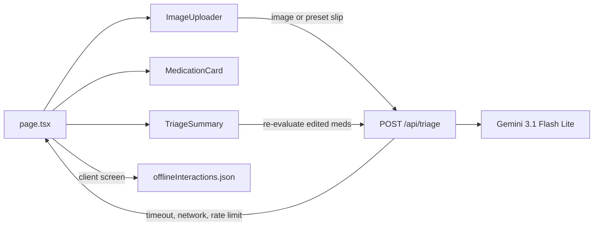

# MediTriage AI

The repo currently contains only [Cursor_Master_Prompt_MediTriage.md](Cursor_Master_Prompt_MediTriage.md). Scaffold a Next.js (App Router) + TypeScript + Tailwind app and implement the spec exactly: vision OCR, interaction screening, human review, and offline fallback. No separate backend.

## Architecture

- Image extract: client sends `{ imageBase64, mimeType }` to [app/api/triage/route.ts](app/api/triage/route.ts).
- Presets: two local prescription slips in `public/samples/` load into the dropzone (no Gemini call until "Extract & Screen").
- Re-evaluate: same route accepts `{ medications: ExtractedMedication[] }` and returns alerts plus a short briefing, without an image.
- API failure: [components/FallbackBanner.tsx](components/FallbackBanner.tsx) plus client screening against [lib/offlineInteractions.json](lib/offlineInteractions.json).

## Stack

- `create-next-app` with TypeScript, Tailwind, App Router, no src dir.
- Dependencies from the spec: `@google/genai`, `lucide-react`, `clsx`, `tailwind-merge`.
- Server route initializes `new GoogleGenAI({})` so the SDK reads `GEMINI_API_KEY`. Model: `gemini-3.1-flash-lite`. Structured JSON via `responseMimeType: "application/json"` and a `responseSchema` matching `TriageResult`.
- [.env.local.example](.env.local.example) contains `GEMINI_API_KEY=`.

## Files to add

Shared types in [lib/types.ts](lib/types.ts) exactly as specified (`ExtractedMedication`, `InteractionAlert`, `TriageResult`).

[lib/offlineInteractions.json](lib/offlineInteractions.json): at least the six required pairs (Warfarin+Aspirin, Warfarin+Ibuprofen, Ciprofloxacin+Theophylline, Metformin+NSAIDs/contrast, ACE inhibitor+potassium, Clopidogrel+Omeprazole), expanded toward 20 critical pairs with aliases (for example ibuprofen/NSAID, lisinopril/ACE inhibitor) so name matching works after edits.

[lib/screenOffline.ts](lib/screenOffline.ts): pure function that normalizes ingredient/brand strings and returns `InteractionAlert[]` plus `requiresHumanReview` and a short briefing. Used only on the client when the route fails.

[app/api/triage/route.ts](app/api/triage/route.ts):

- Reject missing image and payloads over 10MB.
- System instruction: clinical triage copilot for Dr. S.Chandrasena; trade name to generic (Augmentin to amoxicillin + clavulanic acid); HIGH / MODERATE / LOW; flag confidence under 0.70.
- Validate and coerce the model JSON into `TriageResult` (generate ids if missing, clamp confidence, set `requiresHumanReview` if any item is flagged or below 0.70).
- On Gemini errors, return 503 so the client can fall back. Do not swallow validation errors as offline.

UI, dark clinical dashboard in [app/globals.css](app/globals.css) and [app/page.tsx](app/page.tsx):

- Palette from the spec: `#090D16`, `#131C2E`, `#1E293B`, `#F8FAFC`, `#94A3B8`, cyan `#06B6D4`, crimson, amber, emerald.
- Two columns: intake on the left, results on the right. `"use client"` only where state or clipboard is used. Layout stays a server component.

[components/ImageUploader.tsx](components/ImageUploader.tsx): drag-and-drop, file picker, preview, clear, and two preset buttons that load:

- Sample 1 (high risk): Warfarin 5mg daily, Aspirin 100mg daily, Ibuprofen 400mg PRN.
- Sample 2 (moderate risk): Metformin 500mg BD, Ciprofloxacin 500mg BD.

Slips are SVG images with readable prescription text so a recording can run Extract without hunting for a photo.

[components/MedicationCard.tsx](components/MedicationCard.tsx): editable brand, molecule, dosage, frequency; amber badge when `isFlaggedForReview` or confidence under 0.70; delete. List footer has Add medication.

[components/TriageSummary.tsx](components/TriageSummary.tsx): 2–3 bullet briefing, severity-tinted alert cards, Export (clipboard), Re-evaluate.

[components/FallbackBanner.tsx](components/FallbackBanner.tsx): offline banner and the human-review banner when the result requires it.

[README.md](README.md): install, `GEMINI_API_KEY`, `npm run dev`, and how to demo the two samples plus the offline path. State that this is an academic simulation and not a medical device.

## Behavior details

- Extract button shows a spinner and disables while the request is in flight.
- After a successful extract, edits stay local until Re-evaluate.
- Re-evaluate and the initial extract share one client helper: try the API, and on network, timeout, or 503 run `screenOffline` and show the banner.
- Footer line: academic assignment IT6070, not for clinical use.

## Verify

- `npm run build` succeeds.
- With no API key, loading a sample and extracting shows the offline banner and the expected high or moderate pairs.
- Editing a drug and clicking Re-evaluate updates alerts from the offline matrix.
- With a valid `GEMINI_API_KEY`, an uploaded image returns medication cards and alerts from the route. Browser check of upload, presets, edit, re-evaluate, and clipboard export.
